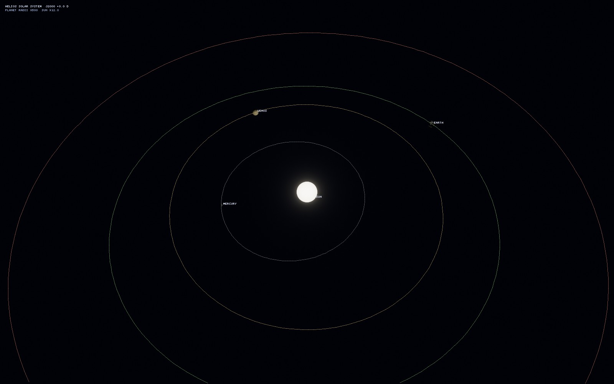

<p align="center">
  
</p>

# Helios

> **Status — the v0.0.1 MVP implementation builds and its automated headless gates pass.** The interactive planet route still requires a deliberate visual/driver acceptance run before a release tag. The branch includes a recursively pinned Vulkan-only Diligent backend, cube-sphere LOD/descent rendering, deterministic terrain/residency evidence, a Diligent precision proof, a Schwarzschild laboratory, and a solar-system lab with a real Sun entity. See the measurable [v0.0.1 contract](docs/V0_0_1_MVP.md), [ROADMAP.md](ROADMAP.md), and [evidence/m0/README.md](evidence/m0/README.md). Planned behavior is not treated as validated until its release gate has evidence.

## v0.0.1 highlights

<p align="center">
  
</p>

The first integrated build turns the design documents into running software. The most interesting
parts:

- **One continuous descent, 10⁹ m to 2 m.** `helios_planet_lod_lab` starts a billion metres from
  an airless procedural world and reaches a two-metre eye height without a loading screen: a
  cube-sphere quadtree selected by screen-space error, camera-relative `double`→`float` patch
  anchors, reversed-Z infinite-far depth, and a hard leaf budget.
- **Deterministic terrain and a measured precision boundary.** `helios_terrain_lab` regenerates
  the same height, normal, slope, residual and error fields and content hashes on every run, and
  verifies bit-identical seams and parent compatibility. `helios_diligent_precision_lab` performs
  the large-coordinate handoff in one compute dispatch from planetary to light-year scale and
  quantifies why the CPU must subtract the camera origin in binary64 before the float32 upload.
- **A real-time black hole checked against a reference.** `helios_black_hole_realtime` integrates
  the Schwarzschild Binet equation per pixel with a Page–Thorne thin disk, Doppler beaming and
  gravitational redshift. `--validate` compares every pixel with the binary64 CPU lab: 57,584
  pixels, zero class mismatches, 2.0e-6 rad median escape-direction error.
- **The Deep-Sky Lab: seven objects, none painted.** One window with a GPU gas-dynamics nebula and
  supernova remnant (MUSCL/HLLC, validated against Sod and Sedov–Taylor), an N-body disk galaxy of
  up to 2.7 million particles carrying individual stars, planets and moons, a lensed neutron
  star/pulsar, the black hole, and a planetary system with terrain, a scattering atmosphere,
  volumetric clouds, and ring gaps at the moons' resonances.
- **A Diligent Engine foundation.** The renderer uses Diligent's static Vulkan backend with
  Direct3D, OpenGL, Metal and WebGPU disabled; Slang is compiled offline to embedded SPIR-V and
  covered by reflection/ABI tests. The pre-migration raw-Vulkan path is kept isolated as a parity
  target.
- **A Sun, and the Solar System around it.** `helios_solar_system` is the first scene with a Sun
  entity: the Sun and all eight planets are bodies on the planet lab's cube-sphere renderer. The
  Sun has a limb-darkened, granulated photosphere (a `star` branch in `shaders/planet_patch.slang`);
  the planets sit on their J2000 Keplerian orbits with individually selected LOD, and the camera
  can fly from a whole-system map to a close-up of any world.
- **A showcase site and evidence.** `site/index.html` collects 4K captures and the method behind
  each object; the M0/M1 evidence bundles record the build, precision, and smoke results.

> **Built with Opus 5.5.** All, if not most, of the code in this repository was written with
> Opus 5.5.

This remains an MVP technical preview. The automated headless gates pass; the full interactive
planet route still needs a recorded visual/driver acceptance run before a release tag. See
[docs/V0_0_1_MVP.md](docs/V0_0_1_MVP.md) and the
[v0.0.1 release notes](docs/RELEASE_NOTES_v0.0.1.md).

Helios is a planned open-source, real-time **Solar-System visualization engine and reference explorer**. Its first public release aims to move a free-flight camera from an interplanetary view to roughly two metres above one detailed planetary surface without a scene-loading transition.

It is intended to be written in C++20 and Vulkan. The community edition is planned for AGPL-3.0-only, with a separately negotiated commercial license for Helios-owned code once the legal and operational pieces are ready.

## The 60-second explanation

The first release, called **v1** in these documents, is exactly the vertical slice delivered by [Roadmap Milestone 10](ROADMAP.md). It is meant to be an interactive technical explorer and a reproducible benchmark, not a game and not yet a general-purpose SDK.

A v1 user should be able to:

1. launch a bundled Solar-System scene at a documented date;
2. follow a preset Earth-approach route or control the camera directly;
3. travel from the planetary context, through the atmosphere, to an eye-height hover above terrain;
4. inspect overlays for coordinate frames, level of detail, performance, and data provenance; and
5. replay the same camera path to compare builds and hardware.

Earth is the accepted v1 **hero body**: one still-to-be-selected curated region uses a documented elevation dataset, while detail below the source resolution is visibly identified as procedural. The Sun, Moon, and other planets provide the astronomical stage and are not promised the same terrain detail in v1.

“Seamless” means that the route does not stop at an explicit scene-loading screen. Terrain and other resources will still stream in the background. “Two metres above the surface” describes a camera position, not a walking character: v1 has no general collision detection/response, avatar, vehicle, fuel, orbital gameplay, vegetation, buildings, or water simulation. A route-only altitude clamp may keep the benchmark camera above terrain without becoming a surface-physics system.

The longer-term vision may grow toward more bodies, interstellar navigation, research tooling, and embeddable engine APIs. Those are separate programs of work, not hidden v1 promises.

## Why build it?

Existing space and geospatial viewers prove that large-scale navigation is useful. Helios's proposed identity is **honest scale**:

- **Measured data stays measured.** A source region records its dataset, datum, native resolution, transformations, and uncertainty.
- **Model-derived astronomy stays model-derived.** Ephemerides and body rotations name the model, reference frame, supported date range, and tested tolerance.
- **Procedural synthesis is visible.** Generated detail is never described as measurement merely because it looks plausible.
- **Display transforms stay display transforms.** Exposure, tone mapping, and artistic color do not change the provenance of the underlying data.

The engine is also intended to be modular internally. Stable third-party plugin or ABI compatibility is not a v1 commitment; that requires real interfaces and a compatibility policy, not just separate static-library names.

## v1 contract

| Area | v1 target | Important limit |
|---|---|---|
| Product | Interactive desktop reference explorer plus a scripted benchmark route | Not a game or full engine SDK |
| Spatial range | Solar-System / interplanetary view to a camera about 2 m above one surface | Interstellar travel is post-v1 architecture work |
| Precision | Sub-millimetre **local numeric resolution** near the surface and a separately measured screen-space jitter budget | A single barycentric `double` at 10¹³ m has about 1.95 mm spacing, so “sub-mm everywhere” is not claimed |
| Terrain | Continuous cube-sphere LOD with roughly 1 m near-camera sample spacing on the hero body | Sample spacing and synthesized detail are not 1 m measurement accuracy |
| Real terrain | One named Earth DEM region with full provenance | Global, uniformly high-resolution measured terrain is not promised |
| Lighting | One Earth atmosphere preset, physical-light conventions, HDR exposure, and tone mapping | Scientific radiative-transfer accuracy is not implied |
| Astronomy | Sun, Earth, Moon, planets, and a catalog-derived star sky over a documented date interval | “Any date” and mission-grade navigation accuracy are not promised |
| Repeatability | Versioned inputs and deterministic seams; exact hashes where integer generation permits, tolerances otherwise | Floating-point GPU output is not promised bitwise-identical across every vendor forever |
| Platforms | One reference platform first; other platforms earn support through the same validation suite | A GPU's release year is not a capability or performance guarantee |

The measurable contract and still-open thresholds live in [docs/VALIDATION.md](docs/VALIDATION.md).

## Is this realistic?

The core vertical slice is technically credible. The from-scratch implementation is still a large rendering, data, numerical, tooling, and release-engineering project. A rough planning estimate for an experienced C++/Vulkan engineer is **94–170 full-time engineer-weeks**, before ongoing maintenance. At roughly half-time, with integration, specialist review, and rework, **four to seven calendar years** is a more credible expectation than a quick solo release.

That estimate is not a promise. Milestones 0–4 exist to retire the risks that could materially change it. See [docs/FEASIBILITY.md](docs/FEASIBILITY.md) for the claim-by-claim assessment and assumptions.

## Technical direction

The current proposal uses:

| Problem | Proposed direction |
|---|---|
| Large coordinates | Frame-tagged `double` positions on CPU; one camera-relative `float32` scene handoff to the GPU |
| Depth | Reversed-Z, an infinite far projection, and a queried 32-bit floating depth format |
| Planet LOD | Cube-sphere quadtree, 33×33 grid patches, screen-space-error selection, morphing, and bounded residency |
| Rendering API | Diligent Engine statically linked with Vulkan as the only enabled backend; the pre-migration raw-Vulkan path remains temporarily isolated for parity evidence |
| Shaders | Pinned Slang compiler, offline SPIR-V compilation, reflection/ABI tests, and a MoltenVK compatibility spike |
| Astronomy | A simple analytic ephemeris backend first, later replaceable by SPICE behind the same frame/time contract; a versioned Gaia DR3-derived star catalog |
| Terrain | Versioned, data-driven generation passes; GPU compute only where its determinism and portability contract is explicit |

Read [docs/ARCHITECTURE.md](docs/ARCHITECTURE.md) for the intended module and runtime design, and [docs/DECISIONS.md](docs/DECISIONS.md) for decisions and revisit triggers.

## Repository guide

The repository contains the engine modules in `src/`, offline Slang shaders in `shaders/`,
tests in `tests/`, and independent MVP applications in `examples/`.

### v0.0.1 applications

| Target | Purpose | Display/GPU behavior |
|---|---|---|
| `helios_planet_lod_lab` | Interactive cube-sphere LOD inspector and scripted ~1e9 m-to-2 m descent, with ImGui controls and telemetry | Diligent/Vulkan window; launch manually |
| `helios_solar_system` | The Sun and eight planets on the cube-sphere renderer: a real emissive Sun body, J2000 Keplerian orbits, orbit/label overlay, close-ups and captures ([lab README](examples/solar_system_lab/README.md)) | Diligent/Vulkan window; `--capture` and `--smoke-frames` are windowless |
| `helios_terrain_lab` | Deterministic height/normal/slope/residual/error images, seam checks, hashes, and residency trace | Headless CPU |
| `helios_black_hole_realtime` | Real-time Schwarzschild renderer: per-pixel null geodesics, Page-Thorne black-body disk, lensed sky; checked per pixel against the CPU reference | Diligent/Vulkan window; `--capture`, `--benchmark` and `--validate` are windowless |
| `helios_black_hole_lab` | Binary64 Schwarzschild null-geodesic reference image and validation report, same disk model | Headless CPU |
| `helios_deep_sky_lab` | Seven objects with physically motivated variants and quality presets: N-body galaxy, GPU gas-dynamics nebula and supernova remnant on a stretched grid, lensed neutron star and pulsar, the black hole of its lab, and a planetary system (height-field terrain, scattering atmosphere, clouds, rings, moons) on the planet lab's cube sphere (`examples/deep_sky_lab/README.md`) | Vulkan window, or windowless `--capture` / `--benchmark` / `--validate-gas` |
| `helios_galaxy_probe` | The galaxy simulation without a GPU: rotation curve, mode amplitudes, star formation | Headless CPU |
| `helios_diligent_precision_lab` | One-dispatch camera-relative precision proof from planetary to light-year world scales | Headless Diligent/Vulkan; opt-in |
| `helios_diligent_probe` | Vulkan device creation plus offscreen clear/readback parity gate | Headless Diligent/Vulkan; opt-in |

| Start here | What it answers |
|---|---|
| [docs/INDEX.md](docs/INDEX.md) | Which document is authoritative, and what should I read next? |
| [docs/PRODUCT.md](docs/PRODUCT.md) | What is the product, who is it for, and what does v1 actually do? |
| [ROADMAP.md](ROADMAP.md) | In what order will it be built, and what proves each milestone? |
| [docs/FEASIBILITY.md](docs/FEASIBILITY.md) | Which expectations are realistic, risky, or not credible as written? |
| [docs/ARCHITECTURE.md](docs/ARCHITECTURE.md) | How is the implementation intended to be divided? |
| [docs/V0_0_1_MVP.md](docs/V0_0_1_MVP.md) | What exactly must the first planet/black-hole MVP demonstrate? |
| [docs/VALIDATION.md](docs/VALIDATION.md) | How will precision, seams, performance, astronomy, and portability be tested? |
| [docs/DATA_AND_PROVENANCE.md](docs/DATA_AND_PROVENANCE.md) | Where do data and generated assets come from, and how are they labelled? |
| [docs/SUPPORT.md](docs/SUPPORT.md) | What does “supported hardware/platform” mean? |
| [docs/GLOSSARY.md](docs/GLOSSARY.md) | What do the specialist terms and acronyms mean? |
| [CONTRIBUTING.md](CONTRIBUTING.md) | What can be contributed at the current stage? |
| [LICENSING.md](LICENSING.md) | What is the intended licensing model and what is still unresolved? |

## Building and contributing

Milestone 0 is complete and Milestone 1 is in progress: the repository now
contains a full CMake build (MSVC 2022 on Windows; presets in
`CMakePresets.json`), a Vulkan 1.3 renderer with headless and windowed smoke
paths, doctest unit suites, and evidence tooling. See [ROADMAP.md](ROADMAP.md)
for current status, `evidence/m0/README.md` and `evidence/m1/README.md` for
verified results, and `evidence/m0/commands.md` for the build/test commands.

The Diligent fork is a recursive submodule. A fresh Windows checkout can be prepared with:

```powershell
git submodule update --init --recursive
node scripts/fetch_deps.mjs --update-lock --write-cmake
cmake --preset windows-dev
cmake --build --preset windows-dev
ctest --preset windows-dev
```

Ordinary `ctest` runs CPU/headless tests only. Physical-GPU checks are registered explicitly:

```powershell
cmake --preset windows-dev -DHELIOS_ENABLE_GPU_TESTS=ON
cmake --build --preset windows-dev
ctest --test-dir build/windows-dev -C RelWithDebInfo -L gpu --output-on-failure
```

Return to the safe default with `cmake --preset windows-dev -DHELIOS_ENABLE_GPU_TESTS=OFF`.
The interactive planet and black-hole windows are never started by CTest; the GPU label only
runs their windowless routes.

The default Diligent configuration disables Direct3D 11/12, OpenGL, Metal, and WebGPU. The MVP
applications use the static Vulkan backend; no Diligent runtime DLL is required.

Documentation issues and corrections are welcome. Code contributions are not being accepted until the reviewed contributor agreement, real legal identity/contact details, and signing workflow exist. See [CONTRIBUTING.md](CONTRIBUTING.md).

## Licensing status

The repository states an AGPL-3.0-only licensing intent and contains a **draft, unreviewed** contributor agreement. The actual licensor(s), chain of title, and banner ownership must be named/confirmed before outsiders are asked to rely on that grant or any commercial terms. Third-party code, datasets, catalogs, and assets keep their own licenses. See [LICENSING.md](LICENSING.md); its plain-language notes are project guidance, not legal advice.

Copyright © 2026 the Helios repository authors. The complete public legal rights-holder notice is still a release blocker; see [LICENSING.md](LICENSING.md).
